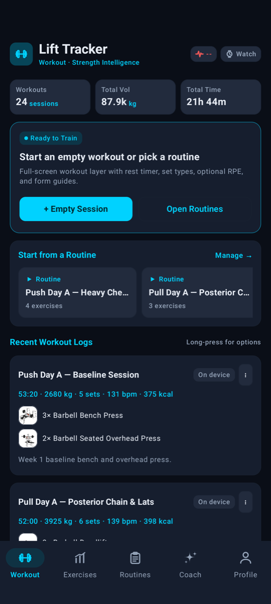
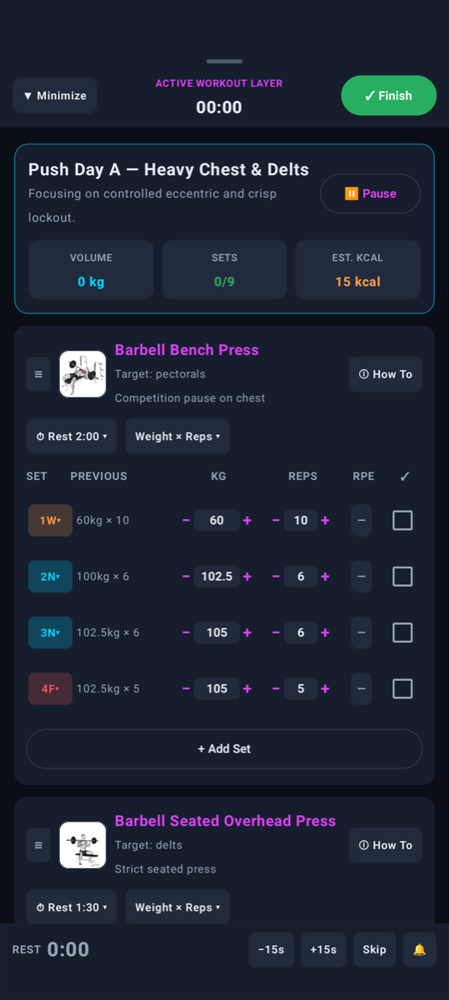
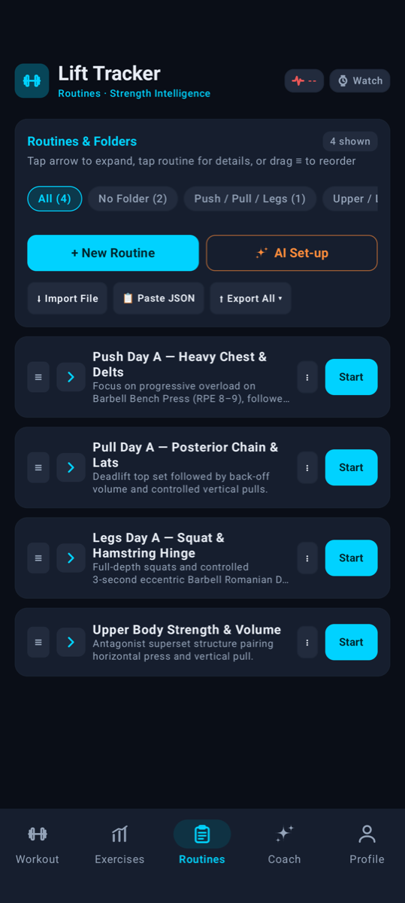
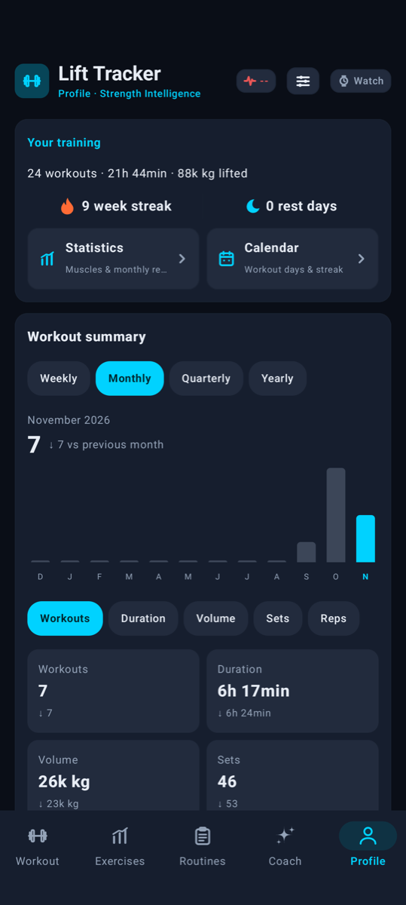
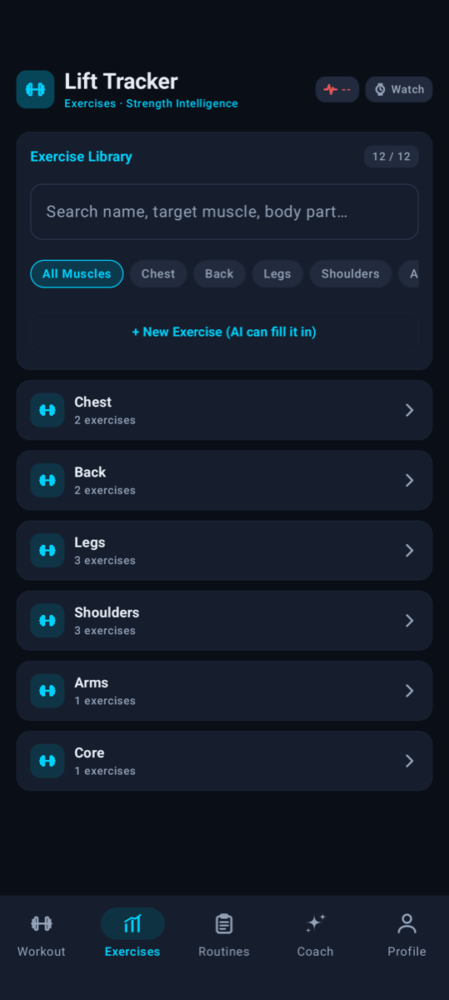
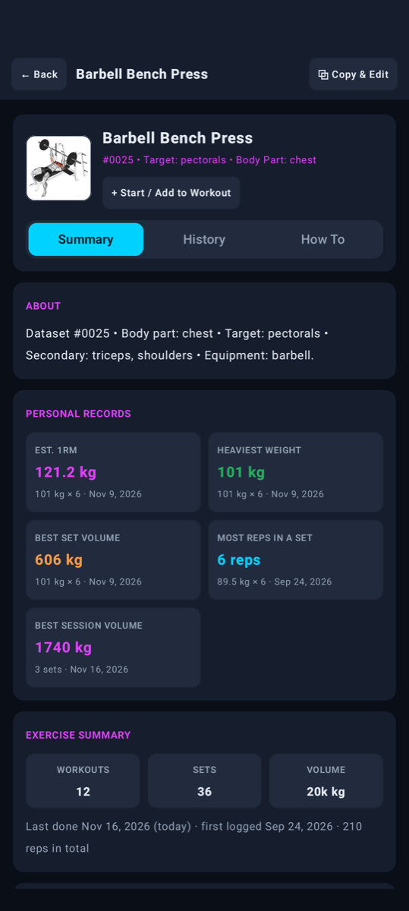
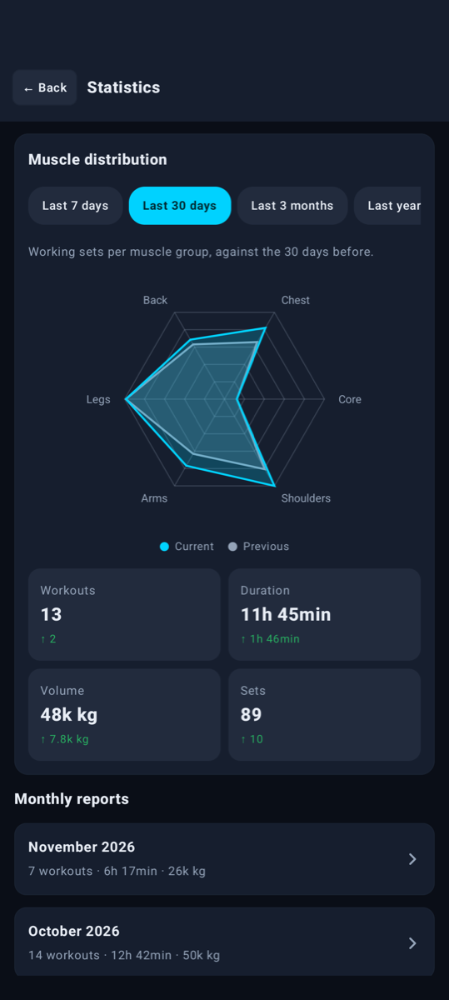
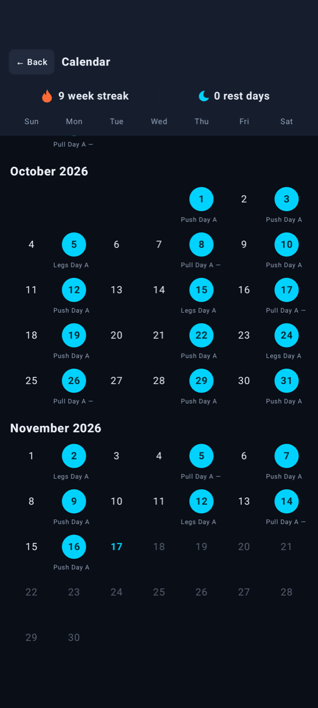
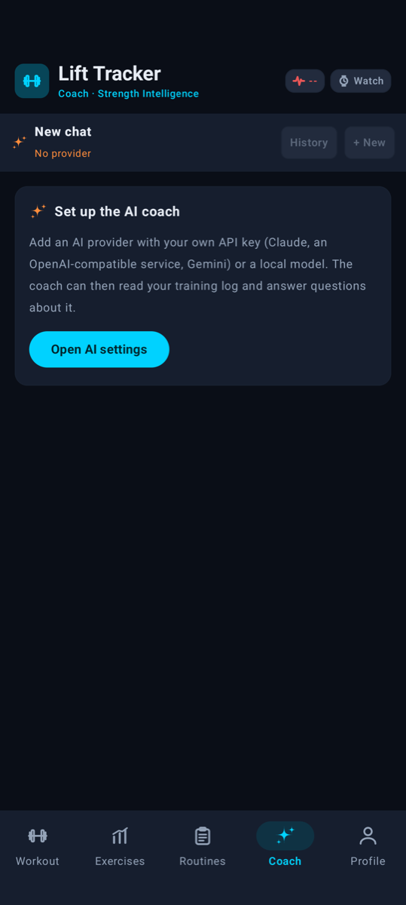
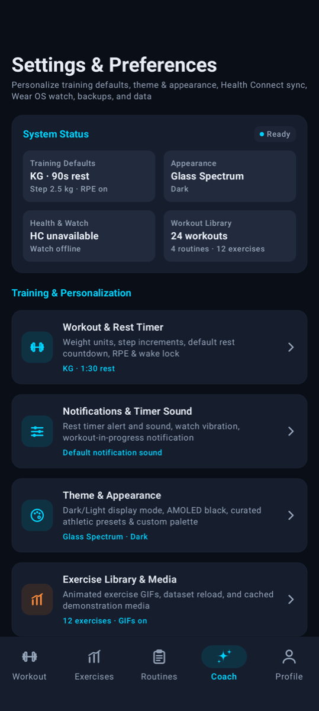

# Lift Tracker

An Android strength-training log with a Wear OS companion. Plan routines, log every set in the gym, follow your progress over time, and ask an AI coach (with your own API key) about your training. Workouts go to **Health Connect**, and your data stays on your phone unless you back it up.

<p>
  
  
  
  
</p>

<sub>Screenshots show the app's built-in sample data.</sub>

## Features

**Logging workouts**
- Start an empty workout or a routine, then log each set: weight & reps, bodyweight reps, duration, or weight & distance.
- Set types: warm-up, normal, failure and drop set. Previous values are shown next to each set.
- Rest timer per exercise, with an alert notification and a live workout notification while you train.
- Reorder, replace or add exercises mid-workout; add notes; save a finished workout as a new routine.

**Routines and exercises**
- Routines organised in folders, with an editor for exercises, sets, rest times and notes.
- An exercise library with pictures, animations, how-to steps and target muscles, filterable by muscle group and equipment.
- Per-exercise summary (best set, estimated 1RM, volume records), full history and charts.
- Create your own exercises, or link one as an alias of a library exercise so its history counts together.

**Progress**
- Profile dashboard: workouts, volume, duration and sets per week, month or year.
- Statistics, a monthly report, a training calendar, and a muscle heat map of what you trained.
- Body weight and body fat, read from and written to Health Connect.

**AI coach (bring your own model)**
- Providers: Anthropic Claude, OpenAI, Google Gemini, or any OpenAI-compatible API (OpenRouter, DeepSeek, Qwen, Kimi, GLM, SiliconFlow, Groq, xAI, Mistral, Ollama, LM Studio…). API keys are encrypted with the Android Keystore.
- Chat with a coach that sees your recent training.
- AI help that writes into the app: fill in a new exercise, set up a routine from a description, or optimise an existing routine.

**Wear OS watch app**
- Start an empty workout or a routine from the watch, follow the current exercise, complete sets and adjust weight or reps.
- Rest timer with −15 / skip / +15 and a vibration when rest ends.
- Heart rate from the watch is recorded with the workout and written to Health Connect.

**Your data**
- Import workout history from CSV (Hevy-style export columns) and routines from JSON.
- Export workouts and routines to CSV or JSON.
- Backups encrypted with a password, to a file or a WebDAV folder (Nextcloud, a NAS…), manually or on a schedule.

## Screenshots

| Workout | Logging | Routines | Exercises | Exercise detail |
| --- | --- | --- | --- | --- |
|  |  |  |  |  |

| Profile | Statistics | Calendar | AI coach | Settings |
| --- | --- | --- | --- | --- |
|  |  |  |  |  |

## Install

Download the APKs from the [latest release](https://github.com/sunrisewestern/Lift-Tracker/releases/latest):

- `LiftTracker-<version>.apk`: the phone app, Android 8.0 (API 26) or newer.
- `LiftTracker-Wear-<version>.apk`: the watch app, Wear OS 3 (API 30) or newer. Install it on the watch with `adb install` (Wireless debugging on the watch). Phone and watch apps are signed with the same key, which the Wearable Data Layer requires.

Health Connect features need the Health Connect app (built into Android 14 and newer). Grant permissions in Settings → Health Connect.

## Build

The Gradle project lives in `app/` and has two modules: `app` (phone) and `wear` (watch). Both share code in `app/shared/`.

```bash
cd app
./gradlew :app:assembleDebug :wear:assembleDebug
```

Run the unit tests:

```bash
cd app
./gradlew testDebugUnitTest
```

Run the Compose UI tests on an emulator:

```bash
cd app
./gradlew :app:connectedDebugAndroidTest
```

`ReadmeScreenshotsTest` regenerates the screenshots above from the sample data and saves them to `/sdcard/Android/data/com.lifttracker.app/files/readme-screenshots/` on the device.

### Release signing

Release builds are signed when these properties are set in `~/.gradle/gradle.properties` (never in the project):

```properties
HEALTHANALYZER_STORE_FILE=/path/to/release.jks
HEALTHANALYZER_STORE_PASSWORD=…
HEALTHANALYZER_KEY_ALIAS=…
HEALTHANALYZER_KEY_PASSWORD=…
```

Without them, `assembleRelease` produces unsigned APKs.

## Releases (GitHub Actions)

[`.github/workflows/release.yml`](.github/workflows/release.yml) runs the unit tests and builds signed release APKs for the phone and the watch:

- On a push to `main` that changes `versionName` in `app/app/build.gradle.kts`, it tags `v<version>` and publishes a GitHub release (skipped when that tag already exists).
- Pushing a `v*` tag does the same for that tag.
- Pull requests and manual runs build the APKs as workflow artifacts.

Release notes come from `release-notes/<version>.md` when present. The workflow needs these repository secrets: `RELEASE_KEYSTORE_BASE64` (the keystore, base64-encoded), `HEALTHANALYZER_STORE_PASSWORD`, `HEALTHANALYZER_KEY_ALIAS` and `HEALTHANALYZER_KEY_PASSWORD`.

## Credits

- Muscle map drawing in `com.fittribe.musclemap` (see its `LICENSE`).
